# ReflectoPatronus

**A modern glass shop software.**  
Developer: Jarred Wheeler

Replacement for the legacy system (flat-glass quoting/invoicing): PostgreSQL 17 + ASP.NET Core API and a React web console (a Windows/Tauri and an iOS client are planned), runnable on **Docker** or **Proxmox LXC** from the same config. Remote access can require a device certificate (mTLS) with post-quantum key exchange.

## Screenshots
Light and dark themes, a built-in knowledge base under **Help**, and editable customers, quotes that become work orders and invoices, credit memos, payments and receivables, printing with per-device printer profiles, and editable maintenance tables. (Entries shown are made-up examples.)

| | |
|---|---|
| 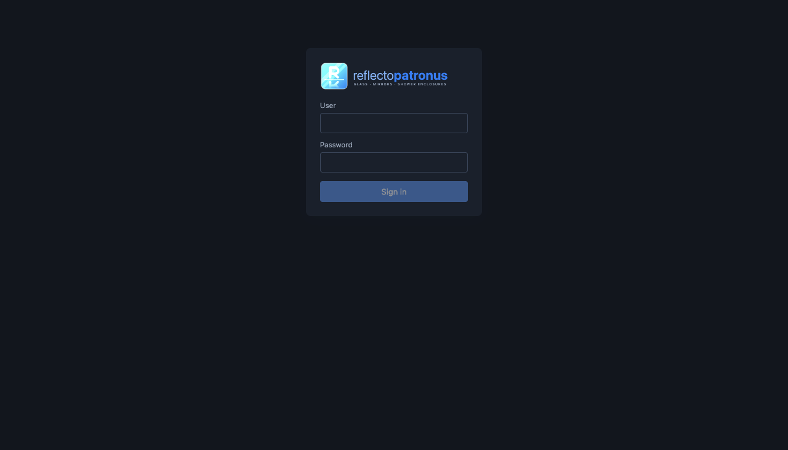 | 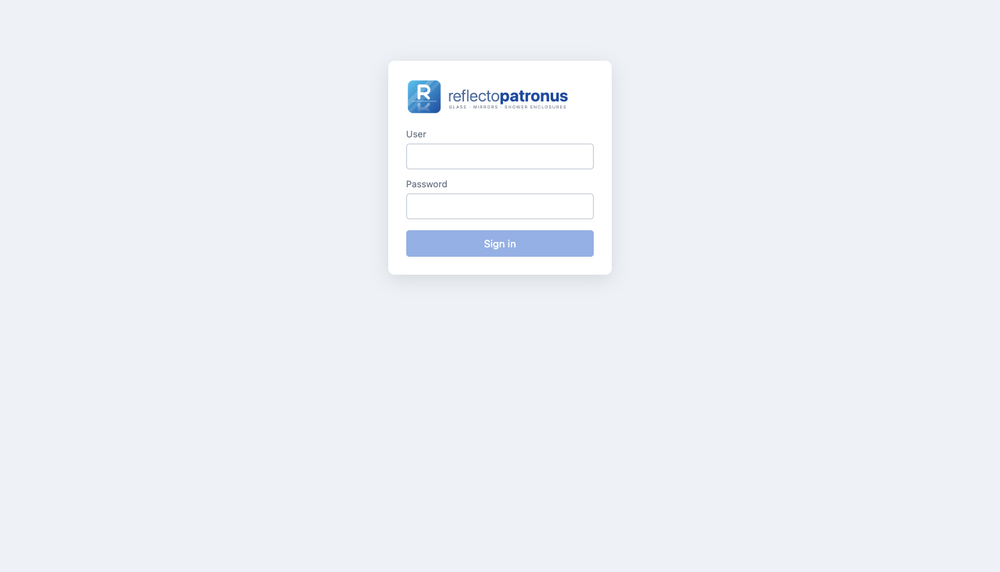 |
| **Customer entry** (dark) 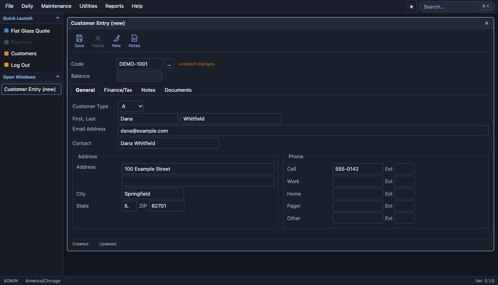 | **Customer entry** (light) 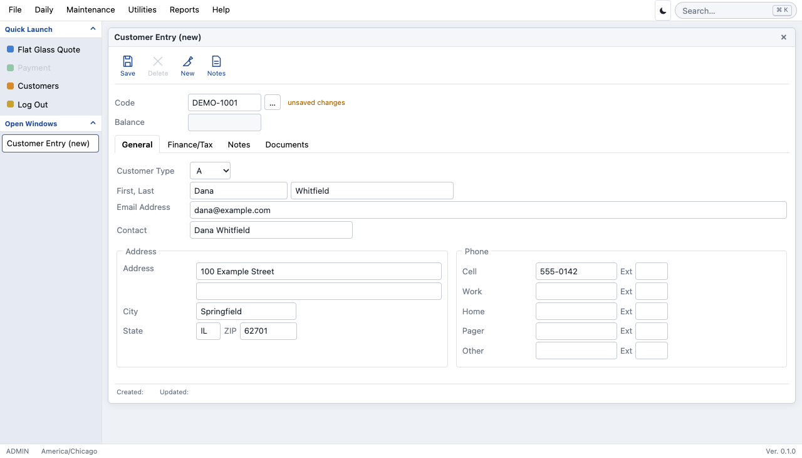 |
| **Maintenance tables** 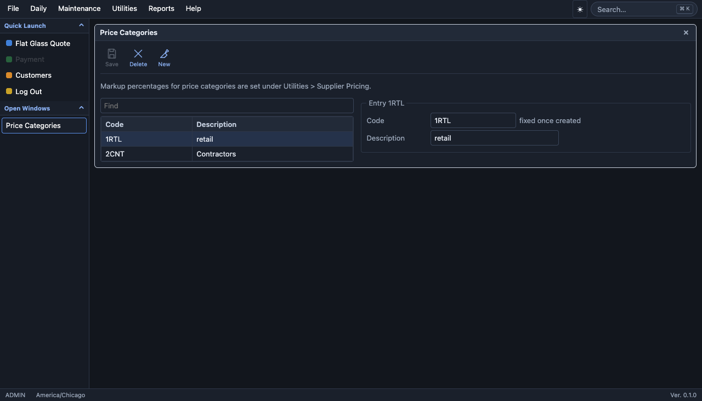 | **Help > Knowledge Base** 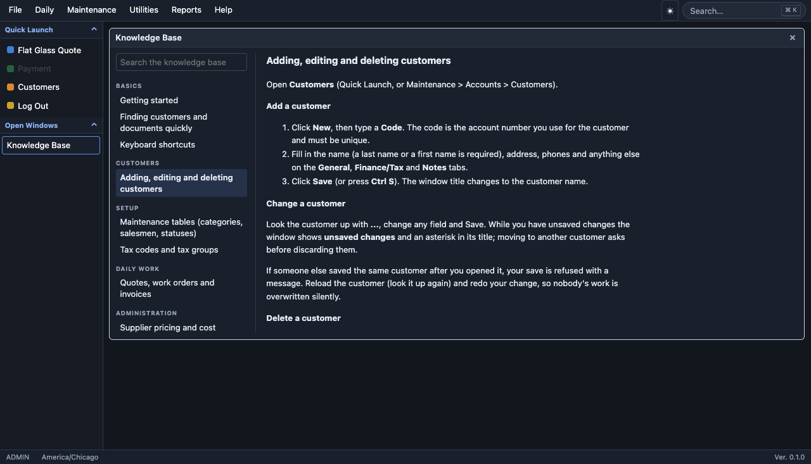 |
| **Quote entry** 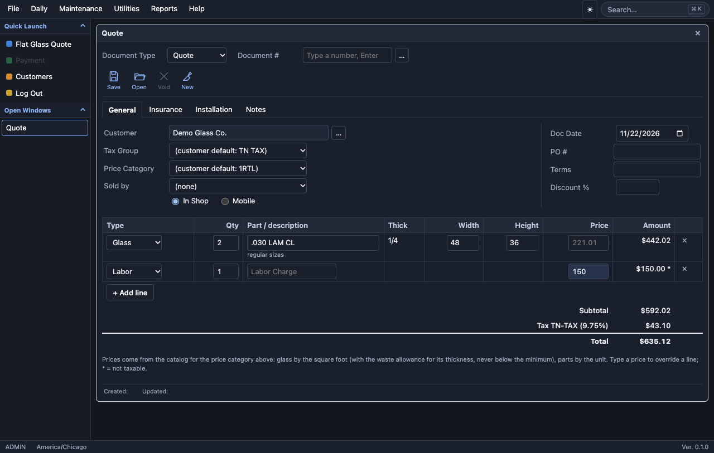 | **Supplier pricing** 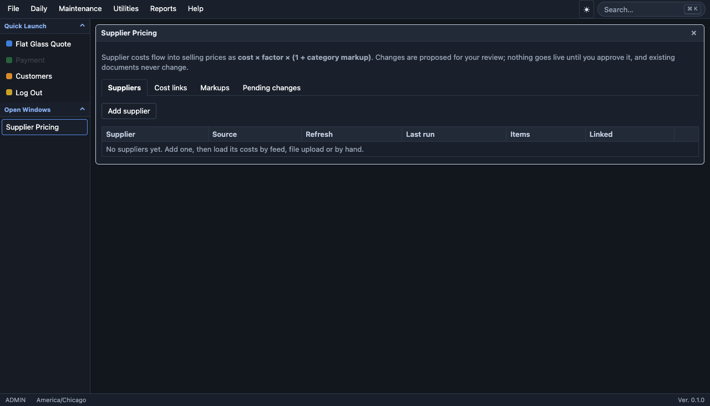 |
| **Import / export** 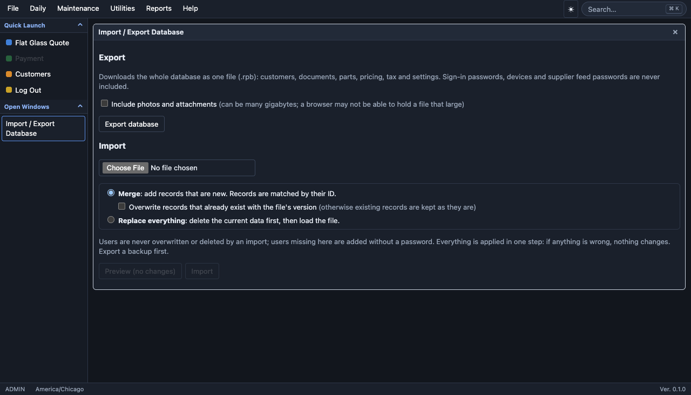 | **Invoice** (quote to work order to invoice) 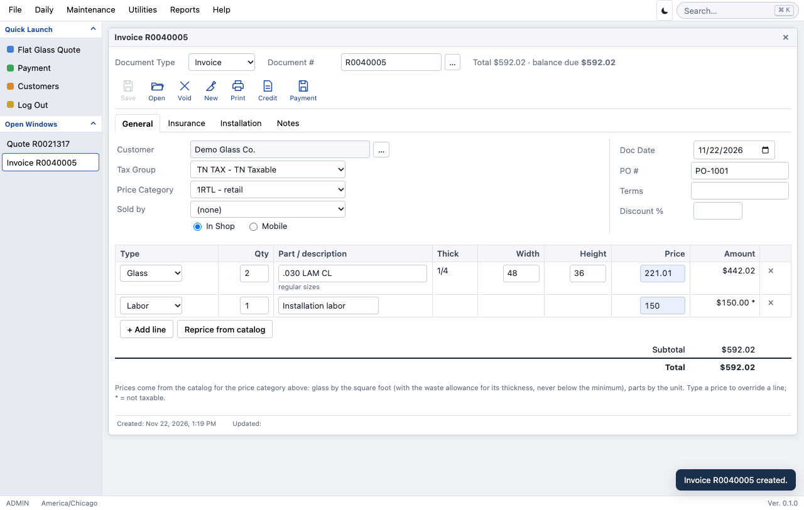 |
| **Receive a payment** 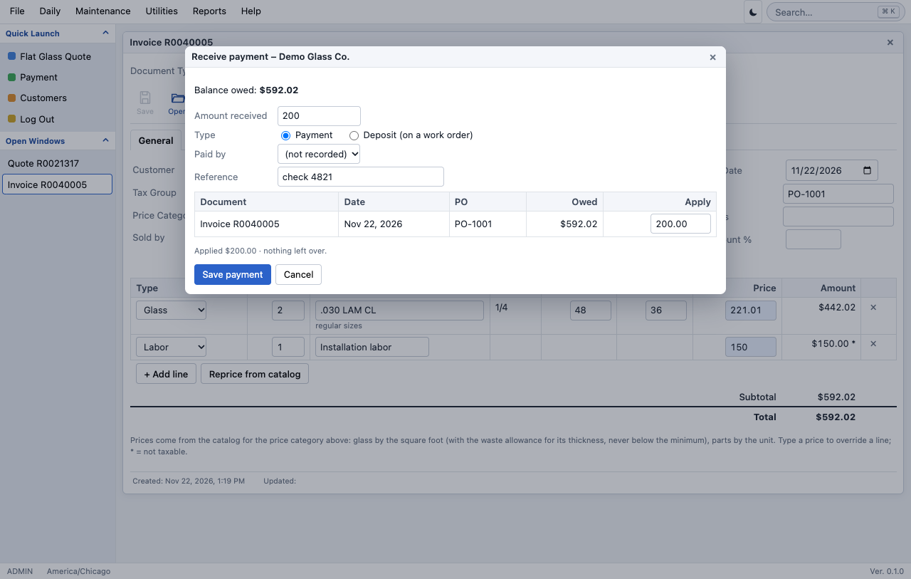 | **Printer setup** (per device) 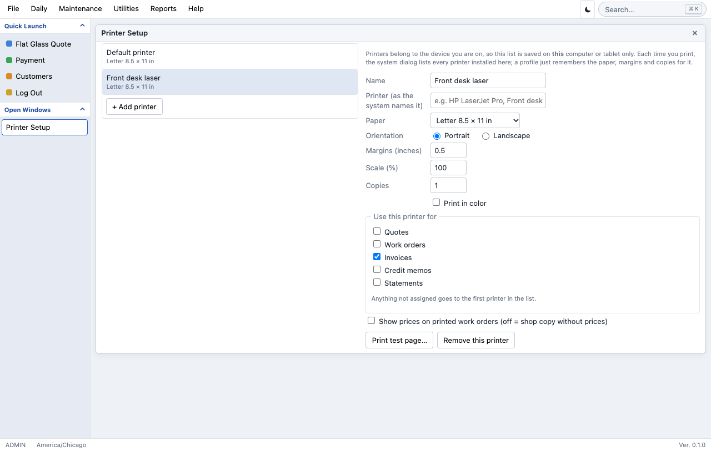 |

| Doc | What |
|---|---|
| [docs/LEGACY-SCHEMA.md](docs/LEGACY-SCHEMA.md) | What is inside the legacy system database (structure only) |
| [docs/DB-DESIGN.md](docs/DB-DESIGN.md) | The PostgreSQL model, what changed from the legacy system and why, open questions |
| [docs/API.md](docs/API.md) | REST API: per-device auth, time zones, customers, maintenance tables; OpenAPI contract |
| [docs/IMPORT.md](docs/IMPORT.md) | Running the legacy system importer, guarantees, first dry-run results |
| [docs/DEPLOYMENT.md](docs/DEPLOYMENT.md) | Docker and LXC setup, converting between them, what is tested |
| [docs/ARCHITECTURE.md](docs/ARCHITECTURE.md), [docs/STARTER-README.md](docs/STARTER-README.md) | Original scaffold notes (TLS/mTLS/PQC gate) |

Quick start (Docker): `./scripts/setup.sh`. It generates the database passwords and certificates, asks you to choose the first administrator's login and password (there is no default login), starts the stack, applies the migrations, verifies the login and then removes the password from `.env`. Add `--ghcr` to use the published images. The manual route (`generate-dev-certs.sh`, edit `.env`, `docker compose up`, `migrate.sh docker`) still works.

`legacy/` holds the legacy system backup and is git-ignored. Never commit it.
